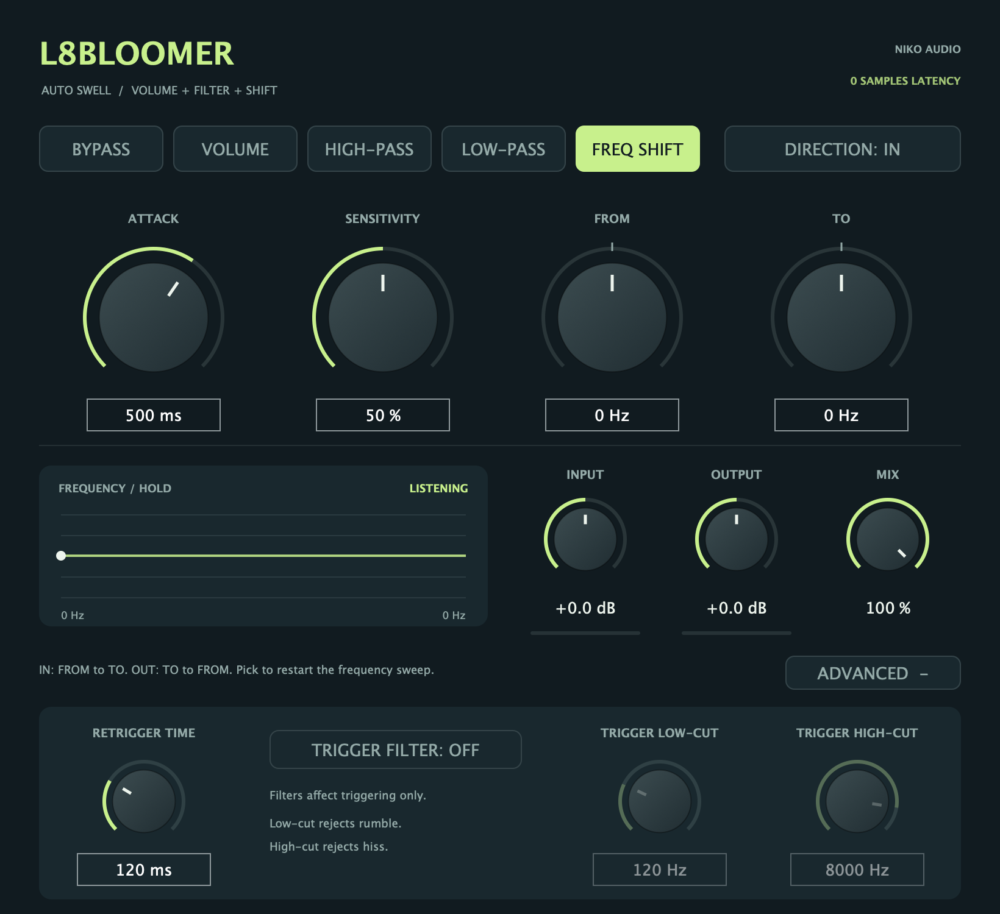

# L8BLOOMER

A transient-triggered auto-swell Audio Unit for Logic Pro, with volume, filter, and dissonant frequency-shift sweeps.

**[Download L8BLOOMER 1.3.1 for macOS](https://github.com/nikoczernin/L8BLOOMER/releases/download/v1.3.1/L8BLOOMER-1.3.1-macOS-universal.zip)** · [All releases](https://github.com/nikoczernin/L8BLOOMER/releases) · [Controls and manual](docs/MANUAL.md)



## Install in Logic Pro

Requires **macOS 11 or later**, an **Intel or Apple Silicon Mac**, and a compatible version of Logic Pro. The download contains an AUv2 `.component` for mono and stereo tracks.

1. Download and unzip **`L8BLOOMER-1.3.1-macOS-universal.zip`** using the link above.
2. Quit Logic Pro.
3. In Finder, choose **Go → Go to Folder…** (`Shift–Command–G`) and enter:
   ```text
   ~/Library/Audio/Plug-Ins/Components
   ```
   Create the `Components` folder if it does not exist.
4. Copy **`L8BLOOMER.component`** into that folder. Keep it as a single bundle; do not copy its internal files separately. If updating, move your previous copy to a backup folder outside `Components` first.
5. Reopen Logic and insert **Audio FX → Audio Units → Niko Audio → L8BLOOMER**.

The release also includes an optional **`Install.command`** helper that installs for your current user and backs up previous versions automatically. From Terminal, type `bash `, drag `Install.command` onto the window, and press Return.

These builds are **ad-hoc signed, not Apple-notarized**. If Logic cannot find or open the plugin, see [installation troubleshooting](docs/INSTALL.md). This includes rescan steps and a narrowly scoped quarantine command for a download you trust.

## Start playing

Start with **Volume**, **Direction IN**, **Attack 500 ms**, and **Sensitivity 50%**. Each accepted pick restarts the sweep, including over a previous note’s sustain or amp noise. Put delay and reverb after it to preserve their tails.

- Volume, high-pass, low-pass, and frequency-shift modes, plus bypass.
- Attack from 1 ms to 20 seconds, transient sensitivity, and one-way IN/OUT sweeps.
- Cutoff and resonance; frequency-shift mode instead offers FROM/TO endpoints (±5000 Hz).
- Input, output, master mix, and adjustable minimum retrigger time.
- Optional low-cut/high-cut filtering of the trigger detector only.
- Double-click defaults, typed values, automation, and session recall.

Reports zero fixed processing latency in every mode. Bypass preserves the original samples. The frequency shifter’s IIR filters alter phase, so a 0 Hz shift is different from bypass. No lookahead is used; some pick attack can pass before detection.

See the [manual](docs/MANUAL.md) for every control and the [validation notes](docs/VALIDATION.md) for tested behavior and limitations.

## Build from source

Install Apple’s **Xcode Command Line Tools** (`xcode-select --install`) and **CMake 3.22+** ([CMake downloads](https://cmake.org/download/), or `brew install cmake` if you use Homebrew).

```sh
git clone https://github.com/nikoczernin/L8BLOOMER.git
cd L8BLOOMER
bash scripts/build.sh
bash scripts/install.sh
auval -v aufx SlBl Niko -strict
```

The build downloads **JUCE 9.0.5**, verifies its SHA-256, compiles a universal **arm64 + x86_64** Audio Unit, runs the tests, and writes `dist/L8BLOOMER.component`. No other project from this workspace is needed. To reuse an existing JUCE 9.0.5 checkout, set `JUCE_DIR=/absolute/path/to/JUCE-9.0.5` before the build command. `CMAKE_BUILD_PARALLEL_LEVEL` controls build concurrency (default 6).

Each release includes a **source-with-JUCE.tar.gz** archive with the matching source, scripts, and JUCE dependency already included. Extract it and run `bash scripts/build.sh`; the build does not need to download JUCE. Apple’s SDK and CMake are still required.

For maintainers, `bash scripts/package-release.sh` packages the built component, installer, matching committed source, JUCE, and SHA-256 checksums into `dist/releases/`.

## License

Copyright © 2026 Niko Czernin. Project code and artwork are licensed under **[GNU AGPL version 3](LICENSE.md)** (`AGPL-3.0-only`). JUCE is used under its AGPLv3 option; bundled third-party components retain their own notices in [ThirdParty](ThirdParty/README.md). The software is provided without warranty.
